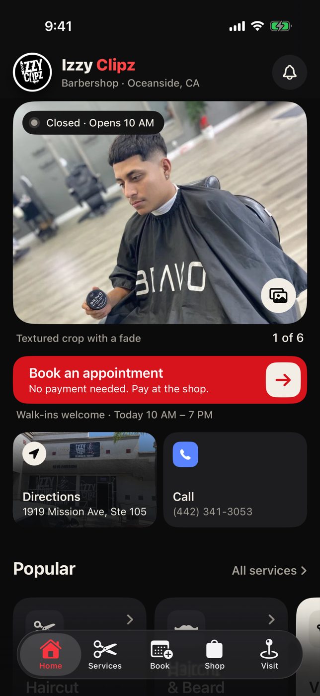
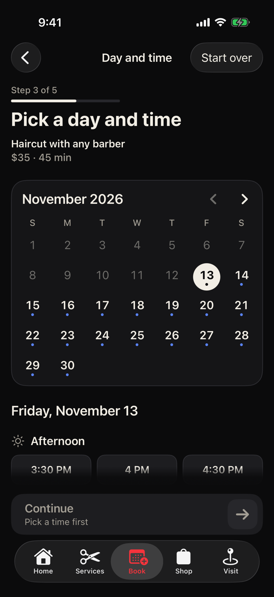
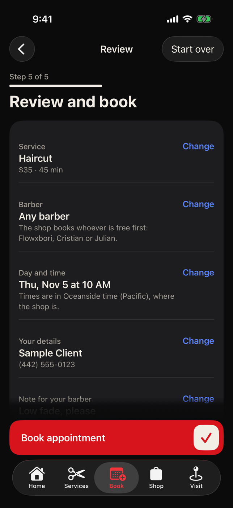
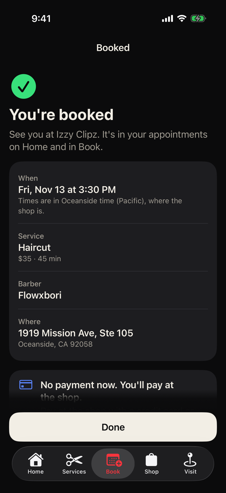
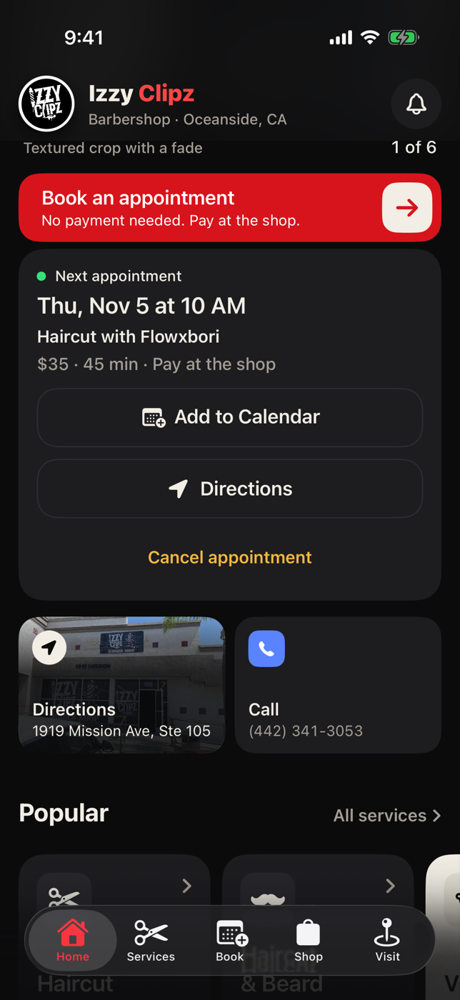
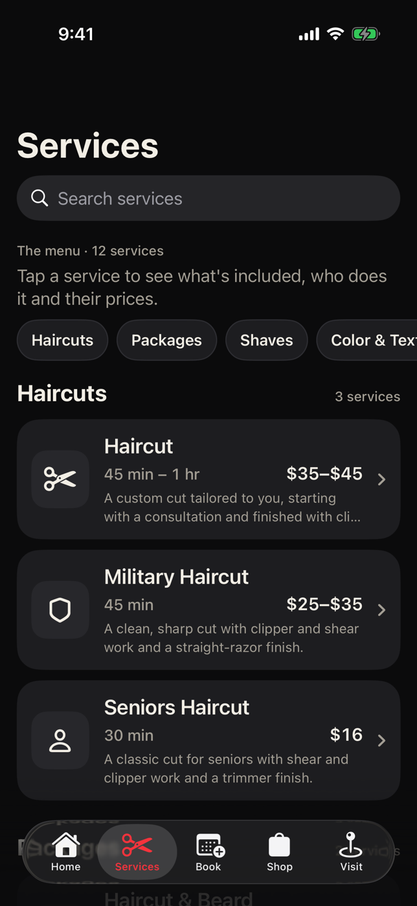
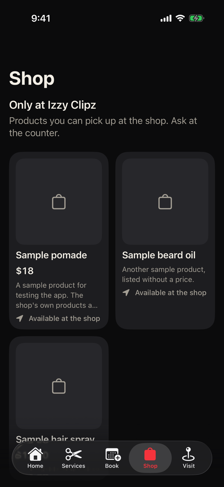
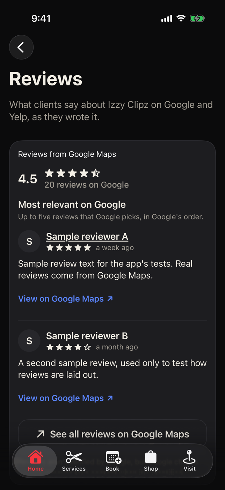

# Izzy Clipz — iOS App

A native iPhone app for **Izzy Clipz Barbershop**, 1919 Mission Ave, Ste 105, Oceanside, CA.

Built with SwiftUI for iOS 17 and later. Clients book an appointment with a barber (or whoever is free) on the shop's live calendar, with **no payment up front**: they pay at the shop (when the shop turns on no-show protection, a card is saved on Stripe's page for its no-show and late-cancellation fees, and nothing is charged at booking). They can cancel in the app, book the same service with the same barber again from a past appointment, get reminders, see the shop's own products (sold only at the shop) and read the shop's Google reviews as they are today, with a link to its Yelp page. No account is needed. The shop's Privacy Policy, Terms of Service, Cancellation & No-Show Policy and Accessibility Statement are a tap away on Visit, and linked where booking agrees to them.

The app talks to the shop's own small server in [`server/`](server/README.md) (bookings, availability, products, reviews). The shop runs its day from the separate owner app, Izzy Clipz Business, in the same project: the schedule, walk-ins, checkouts with services and products, the Analytics tab, the shop's products and its own Stripe account (see [docs/owner-app.md](docs/owner-app.md)).

The look is the shop's dark "Street Drip" palette (ink, bone and one red action per screen) on the system font, with the shop's logo.

<p>
  
  
  
  
</p>
<p>
  
  
  
  
</p>

These screenshots are taken by the UI tests on every push to `main`. The full set is on the [`screenshots` branch](https://github.com/Brian9761/Barber-App/tree/screenshots). The products and reviews in them are the UI tests' sample data, not the shop's.

## Features

- **Home**: the storefront with the live open/closed status, "Book an appointment" (no payment needed), the next appointment (or today's walk-in hours when nothing is booked), Directions and Call, popular services, the crew with your favorite barber first, "See what clients say" (opening the reviews), the shop's products and its Instagram. Pull down to refresh.
- **Book**: five steps, each headed "Step 2 of 5" with a thin bar, and "Start over" in the bar.
  1. A service.
  2. A barber, or **Any barber** when several barbers share the service (the shop's server books whoever is free first). Every barber's own price and length is shown; Flowxbori's 45-minute and hour-long haircuts are separate rows.
  3. A day and time from the shop's live calendar: days with openings are marked on the month, times are grouped into morning, afternoon and evening, in the shop's time zone (with a note when the phone is set to another one).
  4. Name, US mobile number and an optional note for the barber. **Remember me on this iPhone** keeps them for next time; it starts off unless this iPhone already remembers the client. Under the form: "Your details go to Izzy Clipz Barbershop and the services that run its booking, as our Privacy Policy explains." (the policy linked).
  5. A review that says **No payment now. You'll pay at the shop.**, then **Book appointment**, with "By booking, you agree to our Terms of Service and Cancellation & No-Show Policy." (both linked) right above it (with no-show protection, the fee notice and the card section too: see below).

  Then "You're booked", with Add to Calendar, a reminders switch, **Book again** and Done. If someone else takes the time first, the app goes back to the times, refreshed, and says so; the details and the note for the barber are still filled in on the way back. Offline, every screen says what happened and offers Try again and Call the shop; a booking that couldn't reach the shop says "Not confirmed yet", since it may have gone through. Trying again is safe: each booking is sent with a token the app made for it (kept in the Keychain until the booking is confirmed, even if the app is closed), and every try of the same service, barber, time and number gets the same token, also with the name or note fixed in between. So if a try went through but its answer was lost, the next try gets that appointment (as it was first booked) instead of booking twice or finding the client's own time taken. "Start over" is hidden while a booking is being sent. If the client starts another booking anyway (from Home, say), "You're booked" still shows once the first one goes through.
- **Your appointments**: on Home (the next one, and one the shop cancelled before it) and in Book (everything ahead and the last 30 days). The app checks them with the shop when it opens and on pull to refresh, so a cancellation by the shop or a finished appointment shows up. If a check fails (offline, say), Home and Book say so. Cancel appointment asks first, then tells the shop. A past or cancelled one has **Book again** ("Book another time" for one the shop cancelled): the same service with the same barber, straight to the day and time ("Pick a barber" a step back, or step 1 when the service is gone). Reminders come the day before and an hour before (with no-show protection they also say until when cancelling is free: see below); cancelled appointments lose theirs. Each card has Add to Calendar and Directions.
- **No-show protection** (a card on file), when the shop turns it on in Izzy Clipz Business (it's off until then, and the app books exactly as before):
  - **Pick a day and time** and **Review** show a notice that can't be missed, in the shop's own words, e.g. **Full Service Cancellation & No-Show Fee**: "Cancelling less than 1 hour before your appointment, or not showing up, may be charged the full service price ($40). Cancelling in the app more than 1 hour before is free." (only the no-show part when the shop charges no late cancellations). A time that starts less than an hour away adds "This time is less than 1 hour away, so cancelling it more than 15 minutes after booking may be charged $40." (on Pick a day and time right over Continue, where it's seen wherever the time is in the list), from the very moment the time comes inside the window, and VoiceOver says it.
  - **Review** has a **Card on file** section: **Add a card** opens Stripe's secure card page (Apple Pay where Stripe offers it) in a sheet; nothing is charged. Once it's added the section shows "Visa •••• 4242" with Change, and the policy the client agrees to by booking: "No payment now. If you cancel less than 1 hour before your appointment, or don't come, Izzy Clipz may charge $40 (100% of the service) to this card. Cancelling in the app more than 1 hour before is free." **Book appointment** waits until there's a card that's good through the appointment's month. Closing Stripe's page adds nothing; if the way back fails, the app says so and offers Try again (if Stripe saved the card but the shop's server didn't answer, Try again finishes saving that same card). If the shop changed its fee meanwhile, the new policy shows and the client books again.
  - With **Remember me** on, the card is remembered on this iPhone for next time, like the name and number: the next booking shows "Visa •••• 4242 · Change" straight away. An expired card counts as none. With it off (as it starts for someone new), the card is used for that booking only: it's forgotten once it's booked, and the app asks the shop to delete it (`DELETE /api/cards`), which keeps it only while that booking can still be charged. **Your details** (on Book) shows the card with **Remove card**, which asks first, takes it off this iPhone and has the shop delete it, saying what the shop answered ("Your saved card is deleted. It can't be charged any more.", or that it's deleted as soon as no appointment needs it); **Forget my details** does the same with the name and number. If the shop can't be reached, the card is still gone from this iPhone, and the app says to call the shop to have it deleted. A card replaced by a new one, or turned down by the shop, is deleted there too.
  - The appointment (Home, Book and "You're booked") shows "Card on file for no-shows and late cancellations: Visa •••• 4242", and "No-show fee charged: $40" (or "Late cancellation fee charged") once the shop has charged it. Only the shop charges a fee, and only for a no-show or a late cancellation.
  - **Reminders** say where the client stands: "Can't make it? Cancel in the app by 1:30 PM tomorrow so it's free." while cancelling is free, and "Cancelling now may be charged $40." once it isn't (with a 1-hour window, the hour-before reminder comes exactly then). When none of them would come while cancelling is still free (booked the same day, say), one more comes an hour before free cancelling ends: "Can't make it? Cancel in the app by 1:30 PM so it's free. After that, cancelling may be charged $40." It never comes at night (it moves to 8 PM the evening before). "You're booked" says so under the reminders switch.
  - **Cancelling** within 15 minutes of booking is always free, so nothing is asked then. Inside the window after that, it still works, but warns first: "Cancelling now, less than 1 hour before your appointment, may be charged $40, the full service price." with **Cancel appointment** and **Keep appointment**. The shop's server decides by its own clock: if it says the cancellation is late when the phone thought it wasn't, nothing is cancelled and the app asks again with the server's words.
  - **Privacy**: the card number is typed only on Stripe's page, in a private browser sheet, and never reaches the app or the shop's server. Stripe keeps the card; the shop's server keeps its brand, last 4 digits and expiry (and Stripe's ids). The iPhone keeps a card token (the secret the shop's server knows the card by) with the brand, last 4 and expiry in the Keychain, on this iPhone only (it doesn't move to a new phone with a backup).
- **Services**: the shop's 12 services by category with each one's price range and length, jump chips and search. Each service lists who offers it at what price and books that exact item.
- **Shop**: the shop's own products, added by the owner in Izzy Clipz Business: photo, name, price when the shop lists one, description and "Available at the shop". There's no cart and no checkout. Until the shop adds any: "New products are coming soon. Ask at the shop what's in stock."
- **Team**: a page for each barber with a monogram, their own menu, specialties, Instagram if they have one, and "Book with…". Clients can mark a favorite barber, which then appears on Home.
- **Visit**: the storefront, the address with Directions (Apple Maps or Google Maps), Call and Copy address, the week's hours with today marked, a map, walk-in and payment info, the two accessibility lines the owner checked and confirmed ("Room for a wheelchair inside, at the chairs and the counter" and "Accessible parking near the entrance"), always followed by "Questions about getting in or around the shop? Call (442) 341-3053 and we'll help." (the entrance isn't confirmed step-free), the shop's Instagram, links to the website and reviews, and **Legal**: the Privacy Policy, Terms of Service, Cancellation & No-Show Policy and Accessibility pages of the shop's website, in the in-app browser. The website is the build setting `IZZY_WEBSITE_URL` (Info.plist `IzzyWebsiteURL`; `https://izzy-clipz.vercel.app` until the shop's own domain replaces it there): the Website row, the Share link, calendar events and the legal pages all use it.
- **Reviews**: Google's rating, count and up to five reviews in Google's order ("Most relevant on Google"), live when the screen opens or is pulled down (at most every 5 minutes, or every minute while Google's can't be shown; Home doesn't load them, because each Google answer counts against the server's daily limit), under "Reviews from Google Maps", each with its author and a link to it on Google Maps, then "Read our reviews on Yelp", a plain link to the shop's Yelp page. Yelp's reviews are never shown, whatever the server sends: Yelp's API terms bar its rating next to other reviews. "Leave a review on Google" opens Google's form.
- **No photos of people**: the app shows the storefront and the logo, and no photos of clients (a photo of someone goes in only with that person's written permission).
- **Age range**: on iOS 26 and later, the app asks iOS for the person's age range when it opens (Apple's Declared Age Range, one gate at 13): from iOS 26.2 only where iOS says a law requires it, and always on 26.0 and 26.1, which can't say. Someone under 13 sees "Please ask a parent or guardian to book" with the shop's number, and nothing to fill in. Nothing is stored; every other answer, and older iOS versions, carry on.
- **Cut reminders**: an optional "time for a fresh cut" notification every 2–6 weeks after the last cut. Tapping it opens booking.

The tab bar is the system's (Home, Services, Book, Shop, Visit), with no animation between tabs; each tab keeps its screens while another one is showing. The app is dark only and uses the system font with Dynamic Type everywhere, and supports VoiceOver, Reduce Motion and Reduce Transparency.

## Getting started

Requirements: a Mac with **Xcode 16 or later** (Xcode 26 recommended, since the App Store requires its SDK).

1. Open `IzzyClipz.xcodeproj`. If files were added or removed since it was last generated, regenerate it first (see below).
2. Select the **IzzyClipz** target → **Signing & Capabilities**, choose your team, and change the bundle identifier (`com.izzyclipz.app`) to one you own.
3. Set the shop's server in `project.yml` and `IzzyClipz/Info.plist` under `IzzyAPIBaseURL` (keep the two the same). It's `https://izzy-clipz-api.vercel.app` until the server is deployed under its real address. The app only accepts an https address (or http to localhost for a local server: `npm run dev` in `server/`).
4. Pick an iPhone simulator or your device and press **Run** (⌘R).

The project has no third-party dependencies.

## Project layout

```
IzzyClipz/                 The iOS app (SwiftUI)
  App/                     Entry point, the tabs and sheets (RootView), navigation (AppRouter), app data, favorites
  Features/                Home, Booking, Appointments, Services, Team, Shop, Visit, Reviews, Reminders, AgeCheck
  Components/              Shared views: buttons, cards, rows, loading/empty/error states, Instagram card, Safari sheet, Add to Calendar
  Services/                The server's address, the Keychain helper, Stripe's card page (CardSaver), and FakeShopAPI (the in-memory server for UI tests)
  Stores/                  Appointments (with their manage tokens), the client's details, the saved card, the no-show policy, products and reviews
  Theme/                   Colors, text roles, navigation bar style, SF Symbol names
  Resources/               Asset catalog (icon, logo, storefront photo, colors), privacy manifest
Packages/IzzyClipzKit/     The shop's data and logic (hours, calendar, menu, reminders) and the client for the server's API, with no UI dependencies
IzzyClipzTests/            App unit tests
IzzyClipzUITests/          End-to-end UI tests that also capture screenshots, and the recorded demo tour
IzzyClipzBusiness/         The owner app, Izzy Clipz Business, with its own tests (IzzyClipzBusinessTests/, IzzyClipzBusinessUITests/)
server/                    The shop's server (Vercel and Postgres), with its own README
docs/                      The owner app (owner-app.md), the analytics' definitions (analytics.md) and the legal documents (legal/)
project.yml                XcodeGen spec the Xcode project is generated from
scripts/generate_assets.py Builds the storefront photo and the color sets
```

## Updating shop information

The menu, the team and the hours live in one file, `Packages/IzzyClipzKit/Sources/IzzyClipzKit/IzzyClipzData.swift`; the shop's server books against the same data, exported to `server/data/catalog.json`.

- **Prices or lengths**: edit the matching `Offering` line.
- **New service**: add a `Service`, then an `Offering` for each barber who offers it. Each offering needs a menu item ID (any UUID); its ID on the server is `<barber id>/<item id>`, so never change an existing one.
- **New barber**: add a `Barber` with a URL-safe `id` (e.g. `jane-doe`), then their offerings. Their monogram tile shows the first two letters of `name`.
- **Hours**: edit `schedule`, in Pacific time. Times are offered every 30 minutes from opening, as long as the appointment ends by closing, at least 30 minutes ahead and up to 60 days ahead.

Then regenerate the server's copy and deploy the server:

```sh
UPDATE_CATALOG_JSON=1 swift test --package-path Packages/IzzyClipzKit --filter CatalogExportTests
```

A Kit test fails while `server/data/catalog.json` differs from the Kit. Products are managed by the owner in Izzy Clipz Business, not in this file. Google's reviews come live through the server; the app only links to Yelp.

## Font

The app uses the system font (SF Pro) with Dynamic Type text styles. Views pick a `TextRole` (`IzzyClipz/Theme/Typography.swift`), which maps to a text style and weight, so text follows the client's text size setting. Strings are written in sentence case and shown as written.

## Testing

```sh
# Shop logic and the API client (runs on macOS or Linux, no simulator needed)
swift test --package-path Packages/IzzyClipzKit

# The app: unit tests and UI tests on a simulator
xcodebuild test -project IzzyClipz.xcodeproj -scheme IzzyClipz \
  -destination 'platform=iOS Simulator,name=iPhone 17 Pro'
```

GitHub Actions (`.github/workflows/ios.yml`) runs everything on every push to `main`: the package tests on Linux and macOS, plus the app's unit and UI tests on Xcode 26 and Xcode 16 simulators, and a Release device build. Screenshots of every screen are uploaded as a build artifact and published to the `screenshots` branch. You can also start it from the **Actions** tab on any branch: those runs publish to `screenshots-<branch>`, and when Apple silicon Macs are short on capacity you can pick **intel** to use GitHub's Intel Macs instead. The **Demo video** workflow records a walk through the app (`IzzyClipzUITests/DemoTour.swift`) and publishes it to the `demo` branch. The server has its own workflows (see `server/README.md`).

The **Test builds** workflow (`.github/workflows/test-builds.yml`) builds demo versions of both apps, on their sample data, to install without the App Store. Each build from the `test-builds` branch is published as a public prerelease that anyone can download without signing in, with install steps for testers: [Izzy Clipz test build (demo)](https://github.com/Brian9761/Barber-App/releases/tag/test-build). Every new build replaces it, so the links stay the same, including each file's own: `https://github.com/Brian9761/Barber-App/releases/download/test-build/<file>`, for example [IzzyClipz-Demo.ipa](https://github.com/Brian9761/Barber-App/releases/download/test-build/IzzyClipz-Demo.ipa). The notes on that page are `.github/test-build-notes.md`.

The UI tests run the app with `-ui-testing`: it starts with no favorite, details or appointments, never touches the network (an in-memory stand-in for the server answers instead, with sample products and reviews marked as test data), shows a preview of each web address instead of loading it or leaving the app, and keeps manage tokens in memory. Launch arguments set up each situation:

| Argument | What it does |
| --- | --- |
| `-fakeOffline` | Every request fails as if the phone were offline. |
| `-fakeBookingOffline` | The first booking attempt fails offline; Try again works. |
| `-fakeLoseBookingResponse` | The first booking goes through but its answer is lost (it looks offline); Try again gets that same appointment. |
| `-fakeSlotTaken` | The first booking finds the time just taken. |
| `-fakeSlowBooking` | The first booking doesn't answer until the app asks for open times again (another booking reached its times) or two minutes pass, so the app can be used while it's on its way. |
| `-fakeNoProducts` | The shop has no products yet. |
| `-fakeReviewsUnavailable` | Google's reviews can't be shown and Yelp isn't set up. |
| `-fakeYelp` | The server also has Yelp reviews (the app still only links to Yelp). |
| `-fakeBookedAppointment` | Starts with an appointment booked in the app. |
| `-fakeShopCancels` | Appointments the server already holds come back cancelled by the shop. |
| `-fakeSquireAppointment` | Starts with an appointment the previous version saved after booking on Squire. |
| `-fakeSavedDetails` | The client's name and number are already remembered. |
| `-fakeNoShowProtection` | No-show protection is on, with the server's starting settings (the full service price for a no-show or a cancellation less than 1 hour before): the fee notice, the card section and Book waiting for a card. A stand-in for Stripe's page saves "Visa •••• 4242" straight away. |
| `-fakeNoLateCancel` | With `-fakeNoShowProtection`: late cancellations are free, so only no-shows can be charged. |
| `-fakeCardCancel` | The first time Stripe's page opens, the client closes it. |
| `-fakeCardFail` | The first time Stripe's page opens, the way back to the app goes wrong. |
| `-fakeBookedSoonWithCard` | Starts with an appointment booked with a card on file that starts in 45 minutes, so cancelling it now may be charged. |
| `-fakeUnder13` | Starts as if iOS's age range said the person is under 13 (UI tests never ask iOS). |

The test suites check, among other things:

- Business hours and the booking calendar: opening and closing minutes, start times that fit before closing, lead time, the booking window, DST changes, and a phone set to another time zone.
- Availability asked for two weeks at a time and kept by the shop's day; every booking failure turned into words and a way forward; slot starts sent back unchanged and numbers sent in E.164; the same token for every try of a booking (across a relaunch too, and with the name or note fixed) and a new one when the service, barber, time or number changes, so a lost answer then a retry makes one appointment; what was typed on the details step kept on the way back to the times, and replaced when the remembered name and number are changed or forgotten.
- Appointments: tokens kept in the Keychain (never in UserDefaults), a token the Keychain refuses kept for the launch and flagged, statuses refreshed from the server, offline and unknown appointments kept rather than dropped, cancelling (and cancelling again after a lost answer), reminders (and, with a card on file, until when cancelling is free, the one more an hour before it ends when the others come too late, never at night), and the previous version's Squire appointments carried over read-only.
- No-show protection: the card kept in the Keychain (its token and how to show it, on this iPhone only, expiry by the shop's month and the appointment's month, Remember me off, a locked or refusing Keychain), the policy for each choice (asked once a minute, shared, a failure keeping the last answer), when Book waits and what it sends (the token and the policy exactly as shown), the notice and "less than 1 hour away" (shown from the moment the time comes inside the window, not a minute later), what VoiceOver says about a card ("Visa ending in 4242"), adding a card (Stripe's page with a new token, closing it, a page that fails, Try again finishing a card Stripe already has, the server's refusals and limits), `card_required` and `policy_changed` (the policy loaded again, an unknown card dropped), the card not being part of "the same booking", the card going with Remember me and Forget my details (out of the Keychain at once with Remember me off, gone for the next booking), deleting it at the shop (Remove card, Forget my details, a booking made with Remember me off, a replaced or refused card; the shop's answer in its words, an unknown card, one more try when offline, and the card forgotten on this iPhone whatever happens), the 15 minutes after booking being free to cancel, cancelling (the warning inside the window, worked out when asked, asked again with the server's words, only a yes after a warning agreeing to the fee), and the in-memory server answering like the real one (the policy for one barber and for any barber against the server's contract fixture, included items, late cancellations off, its order and words for every refusal, retries before the card, the fee of the barber it lands with, the owner changing the fee, saving cards, deleting them now or once no booking needs them).
- Book again: the same service and barber straight to the day and time, a barber step when the barber's offering is gone, and step 1 when the service is.
- The website: the `IZZY_WEBSITE_URL` setting read safely (https only, the new site otherwise, never the old one), the four legal pages' addresses, and the consent and details lines in the website's words with the right words linked.
- The age check: what each of iOS's age ranges means (only one entirely under 13 shows the screen for a parent or guardian), and that UI tests never ask iOS.
- Every booking path in the UI (Remember me starting off, the details line and the consent line above Book appointment), Book again from a cancelled appointment and from "You're booked", a taken time, offline errors with Try again, a booking whose answer was lost then Try again, a slow booking left for another one, cancelling, a cancellation by the shop then "Book another time", the shop with and without products, the reviews with and without Google (Yelp only ever a link, even when the server has its reviews), the legal pages and the accessibility call row on Visit, and the screen for someone under 13. With no-show protection: adding a card then booking (the card on "You're booked" and the appointment), the next booking using it straight away, protection off asking for nothing, closing Stripe's page leaving Book off, a page that fails then Try again, the no-show-only notice, the warning before a late cancellation, Remove card in Your details (asked first, then the shop's answer), Forget my details forgetting the card (and saying what the shop did with it), a card booked with Remember me off gone for the next booking, the note over Continue for a time less than an hour away, and what the reminders switch says.
- The API client against the server's own contract fixtures, and the catalog export against `server/data/catalog.json`.
- That every SF Symbol and image the app uses exists, that no photo of a person is bundled, and that the privacy manifest declares what's sent to the shop.

## Regenerating the Xcode project

`IzzyClipz.xcodeproj` is generated from `project.yml` with [XcodeGen](https://github.com/yonaskolb/XcodeGen) and committed, so you don't need XcodeGen just to build. If you add or remove files or targets, or change build settings in `project.yml`:

```sh
brew install xcodegen
xcodegen generate
```

New Swift files and resources under `IzzyClipz/` are picked up automatically when you regenerate. The `Info.plist` properties in `project.yml` (including `IzzyAPIBaseURL` and the dark `UIUserInterfaceStyle`) overwrite `IzzyClipz/Info.plist`, so change them in `project.yml` and keep the two the same. If you'd rather work only in Xcode, you can stop using `project.yml` and edit the project directly.

To rebuild the storefront photo and the color sets: `python3 scripts/generate_assets.py --help` (needs `pip install Pillow`). The logo images are files of their own: `Logo` and `LaunchLogo` (and the owner app's `Logo`) are the shop's white logo on a transparent background at 1x, 2x and 3x, and each app's `AppIcon` is that logo on black, all rendered from a vector tracing of the logo the shop sent. When the logo changes, replace them.

## Where the data came from

Collected October 16, 28 and 30, 2026 from the shop's website ([izzyclipzbarbershop.net](https://www.izzyclipzbarbershop.net)), its former Squire booking page, and its Google and [Yelp](https://www.yelp.com/biz/izzy-clipz-barbershop-oceanside) listings. Some sources disagree; the app uses:

| | In the app | Also seen |
| --- | --- | --- |
| Phone | (442) 341-3053 (shop website) | (760) 410-2885 on Squire |
| Wednesday hours | 10 AM – 7 PM (Squire) | 11 AM – 6 PM on Yelp |
| Instagram | @izzy_clipz_barbershop_ (the shop); @izzy_clipz_ on Izzy's profile | |

Please confirm these with the shop before publishing.

The logo is the official one the shop sent, and the storefront photo is the shop's own, from its website. The apps and the website show no photo of a person: the earlier photos of clients' cuts are gone, and one goes back in only with that person's written permission. The team has no headshots online, so barbers appear as monograms.

## Publishing to the App Store

1. **Account**: Apple expects business apps to be published by the business, so use the shop's own Apple Developer account or get the owner's written permission to use the name, logo and storefront photo.
2. **Server and website**: deploy `server/` first and put its address in `IzzyAPIBaseURL` (see `server/README.md`). Put the shop's website in `IZZY_WEBSITE_URL` (`project.yml`): the app opens its `/privacy`, `/terms`, `/cancellation-policy` and `/accessibility` pages, so they must be live there.
3. **App Privacy**: answer **Data Collected**, all **Linked to the user**, **not used for tracking**, for **App Functionality** only:
   - **Contact Info → Name** and **Contact Info → Phone Number**: sent to the shop's server when the client books, so the shop knows who's coming and can reach them.
   - **User Content → Other User Content**: the optional note for the barber.
   - **Financial Info → Payment Info**: once the shop turns on no-show protection, a card saved for its no-show and late-cancellation fees. The card number is typed on Stripe's own page and never reaches the app or the shop's server; the server keeps the card's brand, last 4 digits and expiry (and Stripe's ids), linked to the booking.

   The app sends nothing else and has no analytics or ads. The favorite barber, reminder settings, the remembered name and number, and the appointments stay on the iPhone (the manage tokens in the Keychain, along with a booking that was sent but not yet confirmed, until it is or its time has passed). The shop's server keeps each appointment with the client's name and number for the shop. A card saved for no-show protection stays on the iPhone as a card token with its brand, last 4 digits and expiry, in the Keychain and on this iPhone only (and only until the booking with "Remember me" off); removing or forgetting it asks the server to delete it at Stripe, now or once no booking needs it. The age range iOS shares on iOS 26 and later is used at launch and never stored or sent. The included privacy manifest (`IzzyClipz/Resources/PrivacyInfo.xcprivacy`) declares the same. The privacy policy URL the App Store asks for is the website's `/privacy` page (the one the app links), which should say this, and that reviews are shown from Google Maps (whose terms and privacy policy the Reviews screen links), with Yelp only linked.
4. **Review notes**: booking happens in the app on the shop's own server; nothing is paid in the app (clients pay in person at the shop). With no-show protection on, a card is saved on Stripe's page for the shop's no-show and late-cancellation fees, which are for a service used outside the app (guideline 3.1.3(e)), so In-App Purchase doesn't apply. Products are shown only, not sold in the app. Give App Review a way to book a test appointment the shop will expect (or ask them to cancel what they book).
5. **Age range**: the app has the **Declared Age Range** capability (`IzzyClipz/IzzyClipz.entitlements`, `com.apple.developer.declared-age-range`). Turn it on for the app's identifier in the developer account so the provisioning profile carries it; without it iOS can't answer and the app carries on as for an older iOS.
6. **Screenshots**: the App Store needs full-resolution screenshots; take them in the Simulator (**File → Save Screen**) with the real server, since the test screenshots use sample products and reviews.
7. Archive in Xcode (**Product → Archive**) and upload with the Organizer.
